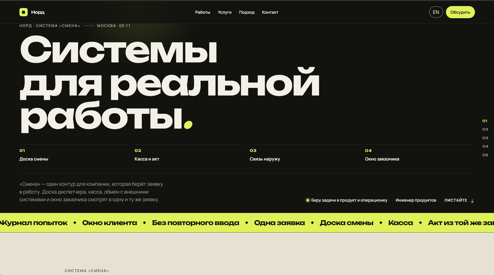
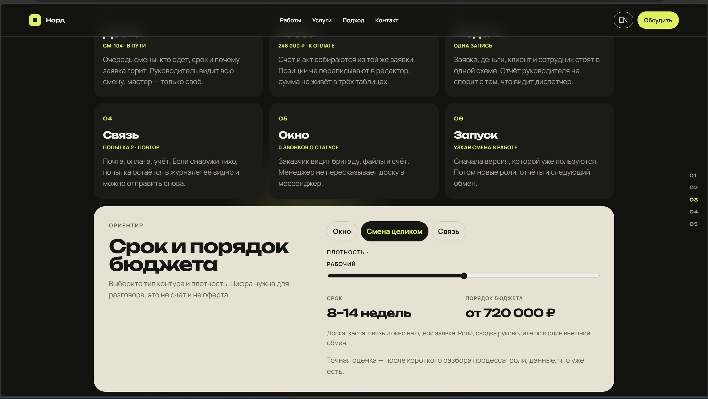
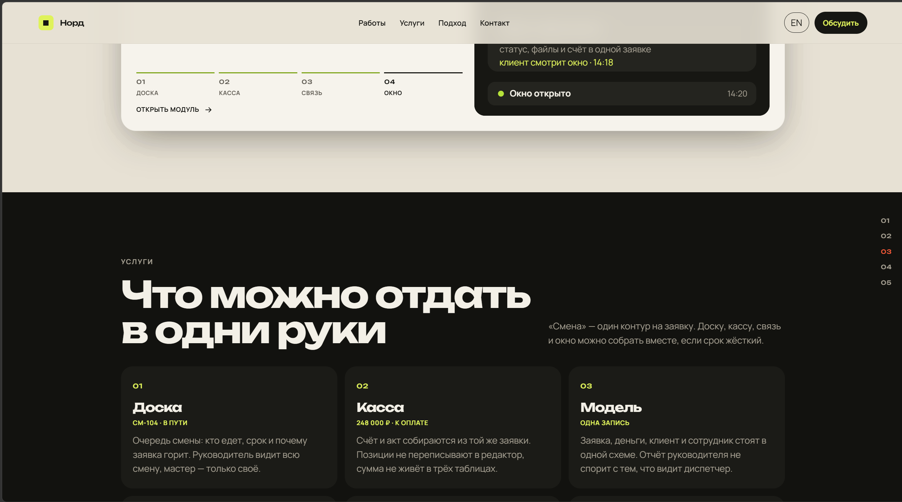

# Норд

Портфолио продуктового инженера. Один сайт, в котором работы, услуги, подход и контакт собраны вокруг реальной операционной задачи — системы «Смена».

## Зачем он нужен

Работы часто показывают как набор красивых экранов без общего смысла. Здесь всё держится на одном контуре: заявка появляется на доске, получает счёт, уходит во внешние системы и остаётся видна заказчику. Сайт объясняет, что можно отдать в одни руки — интерфейс, сервер, данные и обмен.

## Что внутри

- **Система «Смена».** Четыре модуля одной заявки: доска, касса, связь и окно заказчика.
- **Живые карточки.** У каждого модуля лента статусов, цифры смены, ход заявки и экран продукта.
- **Услуги и ориентир бюджета.** Сетка работ и калькулятор срока: окно, смена целиком или связь.
- **Подход.** Сначала процесс и модель, потом экраны. Стек, практика и форма для заявки.
- **Два языка.** Русский и английский, переключение сохраняется в браузере.
- **Движение.** Загрузка, sticky-стек карточек, панель модуля, бегущая строка и аккуратная анимация без лишнего шума.

## Система «Смена»

«Смена» — один контур для компании, которая берёт заявку в работу.

| Модуль | Задача |
| --- | --- |
| Доска | Очередь смены: кто едет, срок и почему заявка горит |
| Касса | Счёт и акт из той же записи, без повторного ввода |
| Связь | Почта, оплата, учёт; попытка остаётся в журнале |
| Окно | Клиент видит статус, файлы и счёт без звонка менеджеру |

## Как это собрано

Статический сайт без сборки. Разметка, стили и данные лежат рядом и открываются через обычный локальный сервер.

```text
index.html
css/styles.css
js/
  ├── content.js   # тексты RU/EN, проекты, услуги, ориентир
  └── main.js      # рендер, анимации, панель модуля, форма
docs/              # скриншоты для README
favicon.svg
```

Клиентский код читает контент из `js/content.js`, рисует карточки и открывает панель модуля. Форма собирает письмо и открывает почтовый клиент — отдельный бэкенд не нужен.

## Стек

| Слой | Технологии |
| --- | --- |
| Разметка | HTML |
| Стили | CSS, Google Fonts (Unbounded, Manrope) |
| Логика | JavaScript |
| Контент | `js/content.js` — RU/EN в одном месте |
| Поставка | любой статический хостинг или `python -m http.server` |

## Как это выглядит

Главный экран. Бренд, система «Смена» и четыре точки входа в контур.



Модуль «Окно». Карточка с лентой статусов, цифрами и экраном, который видит заказчик.


Услуги. Что можно собрать в одни руки: доска, касса, модель и дальше по контуру.



Ориентир. Срок и порядок бюджета для окна, смены целиком или связи.



## Запуск

Из папки проекта:

```bash
python -m http.server 8765
```

Откройте [http://127.0.0.1:8765/](http://127.0.0.1:8765/).

Имя, почта и тексты правятся в `js/content.js`. Сборка не нужна: после сохранения страницу достаточно обновить.

## Структура страницы

1. **Hero** — система «Смена», факты, статус.
2. **Работы** — sticky-стек из четырёх модулей.
3. **Услуги** — доска, касса, модель, связь, окно, запуск.
4. **Ориентир** — срок и порядок бюджета.
5. **Подход** — процесс, модель, ранний запуск, стек и практика.
6. **Контакт** — форма, которая собирает письмо в почтовом клиенте.
